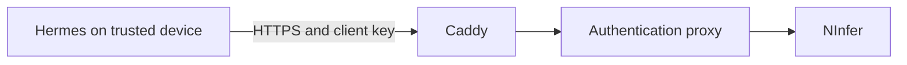

# Encrypted LAN and private-VPN access



Only Caddy's HTTPS port is published on the selected LAN address. The local proxy is bound to `127.0.0.1:8080`. NInfer has no published host port; its backend Docker network is internal. Plain HTTP between containers stays on this machine; this is not encryption against a compromised Windows/Docker administrator.

## Enable

Choose an address actually assigned to this computer and a narrow trusted source IP or CIDR:

```powershell
.\ninfer-manager.cmd -Action EnableLan -LanAddress 192.168.50.115 -TrustedRemoteAddress 192.168.50.0/24
```

The manager requests normal Windows UAC elevation for one firewall rule. If startup fails after applying a new scope, it restores the prior settings and owned rule; recovery can require another UAC approval. It applies on all Windows network profiles, restricted to that local address, TCP port 8443, and the named source subnet. This supports LANs classified Public without changing their network classification. Ports 80 and the raw inference API are not opened.

An optional `-HostName qwen.home.arpa` selects a DNS name instead of the IP; configure that name to resolve to the chosen address on your clients. Reserve the server's IP in your router/DHCP configuration to prevent an address change breaking access.

Private VPN use requires choosing the VPN adapter's assigned IPv4 address and trusted VPN peer range. The manager does not install a VPN, create public tunnels, configure routers, or expose the service to the internet.

## Trust the certificate

Caddy issues and renews a private certificate. The generated configuration supplies a default TLS server name so clients using an IP address without SNI can still select the correct certificate. Its CA and private key persist in the manager's Docker volume. Export **only the public root certificate**:

```powershell
.\ninfer-manager.cmd -Action ExportCertificate
```

The manager prints the SHA-256 certificate fingerprint. Compare it on the client before trusting it. On the server workstation, `ExportHermes` copies the public root into `%LOCALAPPDATA%\hermes\certs\ninfer-root-ca.crt` and configures `providers.qwen.ssl_ca_cert` with `ssl_verify: true`. Trust is scoped to this provider; there are no global certificate-bundle environment overrides and no Windows trust-store change.

For an application that uses the Windows user certificate store, `TrustCertificate` explicitly imports the verified public root into `Cert:\CurrentUser\Root`. Hermes does not require this import.

### Set up a second Hermes device

On the server, create that device's own key and export the public certificate:

```powershell
.\ninfer-manager.cmd -Action CreateKey -ClientName laptop -ExpiresDays 90
.\ninfer-manager.cmd -Action ExportCertificate
```

Transfer the public certificate through a trusted channel, compare its fingerprint, and save it as `%LOCALAPPDATA%\hermes\certs\ninfer-root-ca.crt` on the client. Save the new key in that client's protected Hermes `.env` as `HERMES_CUSTOM_QWEN_API_KEY`; use an editor instead of putting the key in command history. Keep the key's ID so it can be revoked later. Never transfer a CA private key or reuse another device's key.

After installing Hermes and configuring its usual default model, run this on the client, replacing the example server address if necessary:

```powershell
$provider = @{
    name = 'Qwen (NInfer)'
    base_url = 'https://192.168.50.115:8443/v1'
    api_mode = 'chat_completions'
    model = 'qwen3.8-27b'
    models = @{'qwen3.8-27b' = @{context_length = 262144}}
    context_length = 262144
    discover_models = $false
    key_env = 'HERMES_CUSTOM_QWEN_API_KEY'
    ssl_ca_cert = (Join-Path $env:LOCALAPPDATA 'hermes/certs/ninfer-root-ca.crt')
    ssl_verify = $true
    extra_body = @{enable_thinking = $false}
}
hermes --profile default config set providers.qwen ($provider | ConvertTo-Json -Depth 6 -Compress)
hermes --profile default config set compression.model_thresholds.qwen 0.75
hermes --profile default config set auxiliary.compression.provider main
hermes --profile default config set auxiliary.compression.model '""'
hermes --profile default config set auxiliary.compression.base_url '""'
hermes --profile default config set model.persist_switch_by_default false
```

Certificate paths are specific to the client machine. Restart Hermes if an already-running gateway has cached the previous environment, then choose **Qwen (NInfer)** in the default profile's model picker. The saved ChatGPT model remains unchanged. Check [the Hermes guide](hermes-qwen.md) for context and compaction verification.

Do not use `curl -k`, `verify=False`, or global TLS-verification bypasses. A certificate error is an onboarding/path/hostname issue to fix, not an instruction to weaken TLS.

## Disable and verify

```powershell
.\ninfer-manager.cmd -Action DisableLan
```

This first requests removal of the owned firewall rule, then removes the HTTPS listener from Compose. Local authenticated access remains. Existing third-party firewall rules are not changed.

Test from a second device: valid certificate and key must work; missing/wrong key must return 401. From outside the allowed source range, the TCP connection must be blocked. A same-host HTTPS test cannot establish that an independent device's route or firewall path works.

SSE is forwarded incrementally. Timeouts accommodate long prompt processing and compaction. An SSE disconnect closes the upstream connection once the proxy detects the failed write. Cancellation during prefill is not guaranteed to stop GPU work immediately. Revocation rejects new requests but lets existing streams finish.
